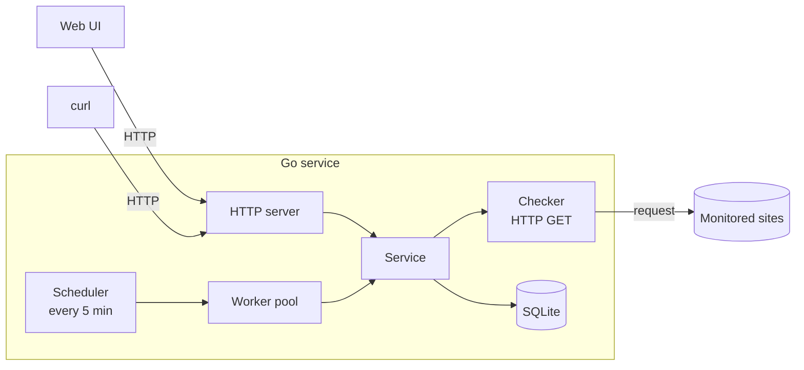

<div align="center">

# Web Availability Monitor

**Know when your websites go down. A small Go service with a tiny web UI.**

[](https://go.dev)
[](https://www.sqlite.org)
[](https://astro.build)
[](#status)

[Quick start](#quick-start) ·
[How it works](#how-it-works) ·
[API](#api) ·
[Configuration](#configuration) ·
[Project layout](#project-layout)

</div>

---

Web Availability Monitor checks a list of websites on a schedule, records the HTTP status and response time of every check, and keeps the history in SQLite. You manage everything through a small HTTP API or the bundled web page.

It is also a learning project: the goal is a real server application with clear package boundaries, a bounded worker pool, and a clean shutdown, not a pile of features.

## Features

- **Scheduled checks.** Every registered site is checked on a fixed interval (5 minutes by default). The first round starts right after launch.
- **Bounded concurrency.** A worker pool (10 workers by default) checks sites in parallel without spawning one goroutine per site. A new round never starts while the previous one is still running.
- **Full history.** Each check stores the HTTP status, response time and timestamp. Failed requests are recorded too, with status `0`.
- **Check on demand.** Trigger a check for any site from the API or the UI without waiting for the next round.
- **Small web UI.** Two static pages, no UI framework, light and dark theme from the system setting.
- **Graceful shutdown.** `Ctrl+C` or `SIGTERM` stops the scheduler and gives the HTTP server a few seconds to finish open requests.
- **Zero external services.** One Go binary and one SQLite file.

## How it works



1. You add a site with an **alias** (its unique name) and a URL.
2. The scheduler lists all sites and puts their aliases on a channel.
3. A fixed number of workers take aliases from the channel and call `Service.CheckURL`.
4. The checker sends a `GET` request with a timeout and measures how long it takes.
5. The service saves the result. A network error is stored as a failed check, it is not treated as a service failure.
6. The API and the UI read the history from SQLite.

A site counts as **up** when the status code is from 200 to 399.

## Quick start

**Requirements:** Go 1.25 or newer and Node.js 22.22 or newer (Node is only needed for the web UI).

```bash
git clone https://github.com/16URL/web-availability-monitor.git
cd web-availability-monitor
```

**Backend**

```bash
CONFIG_PATH=config/local.yaml go run ./cmd/webaviable
```

The API is now available at `http://localhost:8082`.

**Frontend** (in a second terminal)

```bash
cd frontend
npm install
npm run dev -- --port 4321 --host localhost
```

Open **http://localhost:4321**.

> Open the page through `localhost`, not `127.0.0.1`. The API only allows requests from the origin `http://localhost:4321`.

**Both at once**, from the project root. `Ctrl+C` stops both processes:

```bash
(CONFIG_PATH=config/local.yaml go run ./cmd/webaviable & cd frontend && npm run dev -- --port 4321 --host localhost; kill %1)
```

## API

Base URL: `http://localhost:8082`

| Method   | Path                    | Description                            | Success         |
| -------- | ----------------------- | -------------------------------------- | --------------- |
| `GET`    | `/health`               | Liveness check                         | `200`           |
| `GET`    | `/urls`                 | List all registered sites              | `200`           |
| `POST`   | `/urls`                 | Register a site                        | `201`           |
| `GET`    | `/urls/{alias}`         | Get one site                           | `200`           |
| `DELETE` | `/urls/{alias}`         | Delete a site and its check history    | `204`           |
| `GET`    | `/urls/{alias}/checks`  | Check history, newest first            | `200`           |
| `GET`    | `/urls/{alias}/check`   | Run a check now and store the result   | `200`           |

Errors use plain text bodies. Unknown aliases return `404`, invalid input returns `400`, and a duplicate returns `409`.

**Add a site**

```bash
curl -X POST localhost:8082/urls \
  -H "Content-Type: application/json" \
  -d '{"alias": "example", "url": "https://example.com"}'
```

The URL must be absolute and use `http` or `https`.

**List sites**

```bash
curl localhost:8082/urls
```

```json
[{ "ID": 1, "Alias": "example", "URL": "https://example.com" }]
```

**Read the history**

```bash
curl localhost:8082/urls/example/checks
```

```json
[
  {
    "ID": 7,
    "URLID": 1,
    "HTTPStatus": 200,
    "ResponseTimeMs": 143,
    "CheckedAt": "2026-11-09T13:24:14+05:00"
  }
]
```

## Configuration

The service reads a YAML file whose path is given in the `CONFIG_PATH` environment variable. The service exits at startup if it is not set. A ready-made file lives in [`config/local.yaml`](config/local.yaml).

```yaml
env: "local"                         # local | dev | prod
storage_path: "./storage/storage.db"
http_server:
  address: "localhost:8082"
  timeout: 4s
  idle_timeout: 30s
  write_timeout: 10s
checker:
  timeout: 10s                       # per-request timeout for site checks
```

| Key                         | Default        | Meaning                                              |
| --------------------------- | -------------- | ---------------------------------------------------- |
| `env`                       | `development`  | Selects the log format: text in `local`, JSON in `dev` and `prod` |
| `storage_path`              | required       | Path to the SQLite database file                     |
| `http_server.address`       | `0.0.0.0:8080` | Address the HTTP server listens on                   |
| `http_server.timeout`       | `5s`           | Read timeout                                         |
| `http_server.idle_timeout`  | `60s`          | Keep-alive idle timeout                              |
| `http_server.write_timeout` | `10s`          | Write timeout                                        |
| `checker.timeout`           | `10s`          | Timeout of one site check                            |

The check interval (5 minutes) and the number of workers (10) are currently set in [`cmd/webaviable/main.go`](cmd/webaviable/main.go).

The frontend talks to `http://localhost:8082` by default. Set `PUBLIC_API_URL` before starting or building it to point somewhere else.

## Project layout

```
.
├── cmd/webaviable/        entry point: wiring, signals, shutdown
├── config/                YAML configuration
├── internal/
│   ├── config/            configuration loading
│   ├── checker/           HTTP GET check with timing
│   ├── service/           business logic on top of storage and checker
│   ├── scheduler/         periodic rounds and the worker pool
│   ├── httpserver/        routes and CORS
│   └── lib/logger/        slog helpers
├── storage/
│   ├── storage.go         Storage interface and models
│   └── sqlite/            SQLite implementation and tests
└── frontend/              Astro pages (static, no UI framework)
```

Packages depend on interfaces instead of each other's internals: the service only knows the `Storage` interface, so SQLite can be replaced without touching the business logic.

## Development

```bash
go test ./...                       # storage tests
cd frontend && npm run build        # production build of the UI
```

## Status

The project is under active development. Working today: scheduled checks with a worker pool, the full API, the web UI, graceful shutdown.

Planned:

- tests for the checker, service, scheduler and HTTP handlers
- an endpoint that returns the latest check of every site in one request
- configurable interval and worker count
- Dockerfile and a systemd unit for running on a VPS
